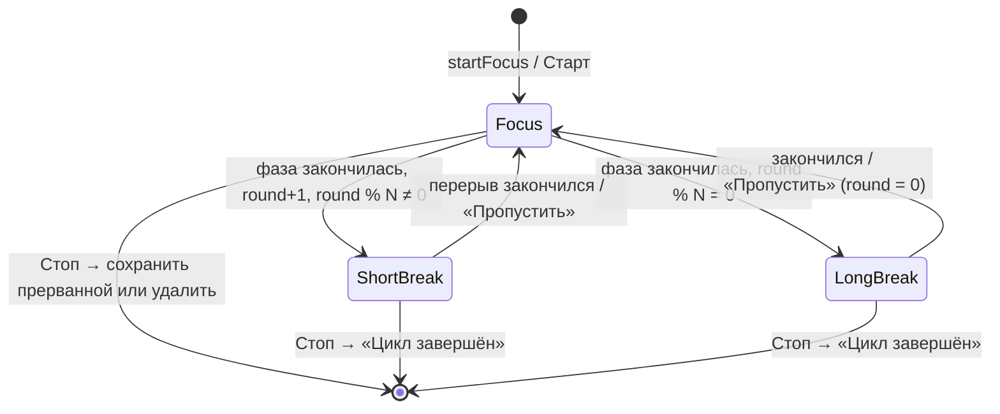

# Фокус и учёт времени

Подробное описание логики фичи. Краткая сводка — в `APP_LOGIC.md` §15. Источник дизайна — Claude Design, файл `Cadence Prototype.dc.html`.

## 1. Из чего состоит

| Слой | Файлы | Роль |
|---|---|---|
| Модели | `Models/TimeEntry.swift`, `Models/FocusSettings.swift`, поля `TaskItem.trackingOverride` / `estimateMinutes`, `TaskList.tracksTimeByDefault` | Записи времени и настройки таймера |
| Хранилище | `Repositories/TimeEntryRepository.swift`, `SwiftDataTimeEntryRepository.swift` | Добавление, правка и удаление записей |
| Движок | `Shared/Focus/FocusEngine.swift`, `FocusRun.swift` | Одна текущая сессия на всё приложение |
| Уведомления | `Services/FocusAlertScheduling.swift` | Локальное уведомление о конце фазы |
| Экраны | `Features/Focus/*` | Экран фокуса, мини-плеер, листы, история |
| Потребители | `TaskEditor`, `Tasks`, `Calendar`, `Insights`, `Profile`, `Lists` | Показ потраченного времени |

`FocusEngine` создаётся в `AppDependencies` и кладётся в окружение SwiftUI. Его состояние читают мини-плеер, экран фокуса, строки задач, редактор и календарь.

## 2. Данные

### 2.1 `TimeEntry`

Отрезок времени `start…end` с необязательной связью с задачей.

- **`kind`** — откуда взялась запись:
  - `focus` — сессия фокуса;
  - `timer` — секундомер на задаче;
  - `manual` — добавлена вручную;
  - `breakTime` — перерыв.
- **`status`**:
  - `completed` — завершена;
  - `interrupted` — остановлена раньше, но сохранена;
  - `cancelled` — отброшена. Остаётся в истории, но в итоги не входит.
- **`durationMinutes`** — длительность, округлённая до минут.
- **`countsAsWork`** — `kind != breakTime && status != cancelled`. Это единственное правило того, что считается работой. Его используют все итоги.

При удалении задачи связь обнуляется (`deleteRule: .nullify`), а история остаётся. Если задачу восстановить через «Отменить», `SwiftDataRepository.relinkTimeEntries` вернёт ей записи.

Записи попадают в экспорт (`ExportService.TimeEntryRecord`), а `SeedService` создаёт пример истории за несколько недель.

### 2.2 Учёт на задаче

| Свойство | Правило |
|---|---|
| `tracksTime` | `trackingOverride ?? list.tracksTimeByDefault ?? false` |
| `effectiveEstimate` | Своя оценка, если она больше нуля. Иначе длительность слота однодневной задачи со временем. Иначе `nil` |
| `trackedMinutes` | Сумма `durationMinutes` по записям с `countsAsWork` |

- Настройку по умолчанию задаёт категория: переключатель «Учитывать время» в `ListEditorView`. Сноска показывает, у скольких задач своя настройка.
- Отдельную задачу переключают в меню «⋯» редактора (`trackingOverride`).

### 2.3 `FocusSettings`

Хранятся в `AppSettings.focus`. Старые сохранения читаются: недостающие ключи берутся по умолчанию.

| Поле | По умолчанию | Диапазон | Шаг в листе |
|---|---|---|---|
| `focusMinutes` | 25 | 5…120 | 5 |
| `shortBreakMinutes` | 5 | 1…30 | 1 |
| `longBreakMinutes` | 15 | 5…60 | 5 |
| `longBreakEvery` | 4 | 2…8 | 1 |
| `autoStartBreaks` | да | | |
| `autoStartFocus` | нет | | |
| `sessionNotifications` | да | | |

- Пресеты: `classic` 25/5/15, `extended` 50/10/30, `custom`.
- Выбор пресета подставляет его длительности.
- Ручная правка длительности переключает пресет на `custom`.
- `longBreakEvery` пресет не меняет.

## 3. Текущая сессия: `FocusRun`

Время считается по меткам, а не по тикам:

```
elapsed = accumulated + (resumedAt != nil ? now − resumedAt : 0)
endsAt  = resumedAt + (total − accumulated)      // только фокус и только пока идёт
```

- **`mode`** — `focus` (Pomodoro, у фазы есть `total`) или `timer` (секундомер без `total`).
- **`phase`** — `focus`, `shortBreak` или `longBreak`. **`round`** — сколько фокусов завершено в цикле.
- **Состояния:**
  - `isActive` — цикл начат, мини-плеер виден;
  - `isRunning` — `resumedAt != nil`;
  - `isReady` — фаза ещё не начиналась (`resumedAt == nil && accumulated == 0`).

  Фокус, открытый кнопкой «Фокус» без запуска, существует, но не активен.
- **Пауза** переносит набранное в `accumulated` и увеличивает `pauseCount`. **Продолжение** ставит `resumedAt = now`.
- **`progress`**, доля кольца:
  - фокус — `elapsed / total`;
  - таймер с оценкой — `(потрачено + elapsed) / оценка`;
  - таймер без оценки — круг в час.
- **Текст на кольце:**
  - фокус — обратный отсчёт `24:59` (секунды округляются вверх, так что `0:00` бывает только в самом конце);
  - таймер — `12:05` или `1:02:03`.

Сессия сохраняется в `UserDefaults` (ключ `focus.run`) при каждом изменении. При запуске приложения восстанавливается только активная сессия. Сразу после восстановления движок вызывает `refresh()`.

## 4. Движок: `FocusEngine`

### 4.1 Тик и досчёт пропущенного

- Пока сессия идёт, раз в 500 мс вызывается `refresh()`. Тик останавливается, когда сессия на паузе или её нет.
- `refresh()` обновляет `now` и в цикле закрывает каждую фазу, у которой `endsAt <= now`.
- Время конца такой фазы берётся настоящее, а не момент проверки. Поэтому после часа в фоне в истории окажутся правильные «фокус → перерыв → фокус».
- Экраны читают `now` и `progress` прямо из движка. Перерисовывается только живой элемент, а не вся страница.
- `RootView` вызывает `refresh()`, когда приложение снова становится активным.

### 4.2 Цикл фокуса



Конец фазы (`completePhase(at:)`):

1. Фаза сохраняется как запись `completed`:
   - у фокуса — с задачей;
   - у перерыва — без задачи, с видом `breakTime`.
2. Создаётся следующая фаза. Она запускается сама, только если включён `autoStartBreaks` (для перерыва) или `autoStartFocus` (для фокуса). Иначе ждёт «Старт».
3. Если фаза закончилась меньше 5 секунд назад и уведомления включены, показывается баннер «Фокус завершён» или «Перерыв окончен». Фазы, досчитанные после фона, баннер не показывают.

### 4.3 Запуск

| Вызов | Что делает |
|---|---|
| `startFocus(task:on:)` | Если уже идёт фокус этой же задачи — только открывает экран. Иначе сохраняет текущую сессию (таймер как `completed`, фокус как `interrupted`) и запускает новый фокус |
| `startTimer(task:)` | Секундомер на задаче. Если уже идёт таймер этой задачи — ничего не делает. Текущая сессия сохраняется так же. Экран не открывается: время видно в строке задачи и мини-плеере |
| `openFocus(on:)` | Открывает текущую сессию или готовит новую, не запуская её |
| `closeScreen()` | Не начатая сессия удаляется, идущая продолжается в мини-плеере |
| `linkTask(_:)` | Привязывает сессию к другой задаче. Уже набранное время фазы уйдёт в неё |
| `skipBreak()` | Сохраняет перерыв и сразу запускает фокус. После длинного перерыва цикл начинается заново |

### 4.4 Правила записи (`record`)

- Запись заканчивается в момент остановки и начинается на `elapsed` раньше. Поэтому паузы в длительность не входят, а время начала — расчётное.
- Неактивная сессия не сохраняется.
- Запись короче 30 секунд (`minimumRecorded`) не сохраняется. Исключение — `cancelled`: она сохраняется, если длительность больше нуля.

### 4.5 «Стоп»

`FocusEngine.stop()` возвращает `StopResult`, а `FocusStopFlow` показывает интерфейс:

| Что идёт | `StopResult` | Интерфейс | Варианты |
|---|---|---|---|
| Сессия не начата | `.ended` | — | Сессия закрывается |
| Фокус | `.confirm(minutes, of)` | Диалог «Завершить сессию?» | **Сохранить N мин** — запись `interrupted` и тост. **Удалить** — запись `cancelled`. **Продолжить** — фокус всё это время шёл |
| Перерыв | `.cycleEnded` | Тост «Цикл завершён» | Перерыв сохранён как `completed` |
| Таймер | `.saveTimer(start, end)` | Лист «Сохранить время» | Таймер встаёт на паузу. **Сохранить** — запись `timer` с поправленными временами. **Не сохранять** — запись `cancelled`. **Отмена** или свайп вниз — таймер продолжает идти |

У каждого места с кнопкой «Стоп» (экран фокуса, карточка сессии в редакторе задачи) свой `FocusStopFlow`. Иначе диалог открылся бы под полноэкранным экраном, который сейчас наверху.

### 4.6 Уведомления

- `scheduleAlert()` вызывается при каждом изменении сессии.
- Если фаза идёт и включён `sessionNotifications`, ставится одно локальное уведомление (`focus-phase-end`) на `endsAt`. Новое заменяет старое.
- На паузе, без сессии и в режиме таймера уведомление снимается.
- Без разрешения на уведомления ничего не ставится.

### 4.7 Смена настроек

`updateSettings` / `settingsChanged()`: если фаза фокуса ещё не начиналась, она получает новую длину. Идущая фаза не меняется, а уведомление переставляется.

## 5. Экраны

### 5.1 Где можно начать

- **Строка задачи** (`tracksTime`): кнопка таймера и «потрачено / оценка». У идущей сессии отметка «живая».
- **Редактор задачи**, блок «Потрачено» (только у сохранённой задачи с учётом):
  - полоса к оценке, «Осталось …» или «… сверх оценки»;
  - оценка шагом ±15 мин (без своей оценки шаг идёт от длительности слота);
  - «Начать фокус», «Запустить таймер», «Добавить вручную»;
  - карточка идущей сессии: пауза, открыть, стоп;
  - последние записи — три или все.

  «Добавить вручную» предлагает последние 30 минут, а конец округляется вниз до 5 минут.
- **Профиль**, группа «Фокус»: «История фокуса» и «Таймер фокуса» (значение «25/5» или «40/7 мин»).

### 5.2 Экран фокуса (`FocusView` + `FocusScreenViewModel`)

Экран полноэкранный. `FocusEngine.screenHost` определяет, кто его показывает:

- `.root` — `RootView`, поверх приложения;
- `.editor` — `TaskEditorView`, потому что редактор сам полноэкранный.

Содержимое:

- шапка: задача (нажатие открывает выбор задачи), настройки (кроме таймера), закрыть;
- кольцо 264 pt (220 pt при высоте экрана меньше 700 pt): время, фаза или «на паузе», подпись «из 25 мин» или «потрачено / оценка»;
- точки сессий цикла и счётчик «Сессия 2 из 4» (только в фокусе);
- кнопки:
  - «Стоп» (у таймера — «Стоп и сохранить», в перерыве — «Завершить цикл»);
  - «Старт», «Пауза» или «Продолжить»;
  - «Пропустить» (только в перерыве);
- пресеты, пока фокус не начат. «Свой» открывает настройки;
- сводка «Сегодня: 1 ч 10 мин · 3 сессии», в которую входит идущая работа, и ссылка «История» (только над приложением).

### 5.3 Мини-плеер и баннер

- **Мини-плеер** — тёмная плашка над таб-баром, пока сессия активна и экран закрыт. На «Задачах» и «Календаре» он отодвинут от кнопки «+», и тост поднимается над ним. Нажатие открывает экран фокуса.
- **Баннер** появляется сверху при конце фазы и исчезает через 5 секунд. Нажатие открывает экран.

### 5.4 Листы

- **`TimeEntryEditorViewModel`** — режимы `new`, `edit` и `fromTimer`:
  - поля: задача, день (только прошлые и сегодня), начало и конец шагом 5 минут;
  - конец должен быть позже начала;
  - запись через полночь обрезается концом дня (23:59);
  - у `edit` есть «Удалить», у `fromTimer` — «Не сохранять».
- **«Сессия»** (`SessionDetailViewModel`):
  - метки категории, вида и статуса;
  - «Фактически»: дата, начало, конец, длительность;
  - «План»: слот задачи и «всего на задаче / оценка»;
  - «Изменить», «Удалить», «Открыть задачу».

  Удаление записи из листа правки закрывает и лист сессии. Редактор задачи открывается только после того, как лист закроется: иначе SwiftUI не покажет новый экран, пока старый уезжает.
- **«Таймер фокуса»** (`FocusSettingsViewModel`) — пресет, длительности, «длинный перерыв после N», автозапуск и уведомления.
- **Выбор задачи** — до 12 невыполненных задач: сначала с датой по порядку, потом без даты.

### 5.5 Календарь

- В «Дне», «3 днях» и «Неделе» записи с `countsAsWork` рисуются полосой у правого края колонки, а карточки задач в такой колонке становятся уже:
  - в «Дне» полоса шириной 78 pt, со штриховкой и подписью;
  - в «3 днях» 12 pt, в «Неделе» 6 pt.
- Прерванная запись помечена «остановлена».
- Идущая работа рисуется растущим мерцающим блоком в колонке сегодняшнего дня. Перерывы и не начатая фаза туда не попадают.
- Нажатие на полосу открывает лист «Сессия».
- В «Месяце» под числом подпись учтённого времени («1ч10мин»), в легенде пункт «Учтено».
- Под списком дня раздел «Учтённое время» со строками записей. Идущая сессия видна в нём строкой «Идёт», если выбран сегодняшний день.

### 5.6 Аналитика

Раздел «Учтённое время» стоит над показателями задач и виден, если есть хотя бы одна запись. Он считается за выбранный период (неделя, месяц, год):

- **Итоги:**
  - сегодня;
  - за период и в среднем за прошедший день;
  - сессии фокуса и доля завершённых;
  - средняя и самая длинная запись.
- **График по дням, неделям или месяцам** и среднее значение.
- **Фокус и перерывы:** доля фокуса. Перерывы считаются без отброшенных.
- **По категориям:** записи без задачи идут строкой «Без задачи».
- **Оценка и факт:** пять задач с наибольшим временем.

### 5.7 История фокуса

`FocusHistoryView` открывается из Профиля, Аналитики и экрана фокуса (`FocusRoute.history`):

- итоги «Сегодня», «7 дней», «Сессии» и столбики за 7 дней — только работа;
- фильтр: все, завершённые, прерванные, отброшенные;
- записи сгруппированы по дням, сначала новые. Перерывы не показываются;
- сначала видны 7 дней с записями, дальше кнопка «Показать более ранние». Смена фильтра снова сворачивает список;
- нажатие открывает «Сессию», а «Открыть задачу» открывает редактор.

## 6. Что где считается

| Место | Сохранённые записи | Идущая сессия |
|---|---|---|
| Строка задачи и блок «Потрачено» | `countsAsWork` | Входит (`trackedMinutes(for:)`) |
| Экран фокуса, «Сегодня» | `countsAsWork` за сегодня | Входит (`liveInterval`) |
| Календарь, полосы и «Учтённое время» | `countsAsWork` | Отдельный живой блок и строка «Идёт» |
| Календарь, ячейка месяца | `countsAsWork` | Не входит |
| Аналитика | `countsAsWork` за период | Не входит |
| История фокуса | Все, кроме перерывов (итоги — `countsAsWork`) | Не входит |

Идущая работа — это не перерыв, сессия активна и набрано больше нуля секунд (`FocusRun.isTrackingWork`).

## 7. Тесты

Тесты на Swift Testing, с фейковыми репозиториями, `FixedClock` и движком с `autoTick: false`:

- `FocusEngineTests`:
  - фазы и автозапуск, досчёт после фона;
  - минимальная длина, Stop во всех режимах;
  - восстановление сессии, уведомления.
- `FocusScreensTests` — экран фокуса, листы записи и сессии, настройки, редактор.
- `CalendarTrackingTests` — полосы, живой блок, месяц, «Учтённое время».
- `FocusHistoryTests` — итоги, фильтры, «Показать более ранние», переход к задаче.
- `TaskTimeTrackingTests` — учёт в строках задач, редакторе и категориях.
- `TimeTrackingModelTests`, `SwiftDataTimeEntryRepositoryTests` — модель и хранилище записей.
- Записи в примере данных и экспорте покрыты в `SeedServiceTests` и `ExportServiceTests`.

Подробно — `TEST_PLAN.md`, этап 4.

## 8. Отложено

- Экран блокировки и Live Activity (ActivityKit). Пока о конце фазы сообщает только локальное уведомление.
